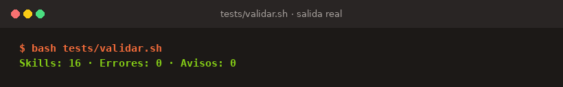

# Cómo contribuir · Contributing

¡Gracias por querer mejorar Taller! Toda ayuda suma: reportar una falla, proponer una skill o corregir un texto.

*English: issues and pull requests are welcome in English or Spanish. Every change ships with its eval and must pass `tests/validar.sh`.*

## Reportar una falla

Abrí un issue con la plantilla **Falla** e incluí: herramienta (Claude Code, Codex, ChatGPT, Cursor), versión de Taller, el pedido exacto y la respuesta. Con eso se puede convertir en una regresión automática.

## Proponer o mejorar una skill

1. Leé `skills/crear-skill/SKILL.md`: explica la anatomía de una skill.
2. Cada skill vive en `skills/<nombre>/SKILL.md` con `name` y `description` (máx. 200 caracteres) en el frontmatter, y pesa menos de 8 KB.
3. Escribí instrucciones en positivo y con el porqué. Evitá mayúsculas de presión (MUST, NEVER): `tests/validar.sh` las rechaza.
4. Sumá o actualizá `evals/skills/<nombre>.md` con al menos 3 pedidos y el comportamiento esperado.
5. Si arreglás una falla vista en una prueba real, agregá un caso bueno y uno malo en `evals/regresiones/casos/` y su revisión en `evals/scripts/revisar-respuesta.py`.
6. Si cambiás una skill de contenido, actualizá `docs/taller-chatgpt.fuente.md` y corré `scripts/generar-chatgpt.sh`.

## Antes del pull request

```bash
tests/validar.sh
```



Tiene que terminar con `Errores: 0`. La misma prueba corre en GitHub Actions en cada pull request.

## Estilo

- Español claro, con voseo o neutro, frases cortas.
- Ejemplos concretos antes que reglas abstractas.
- Nada de llamadas de red ni telemetría en scripts o hooks.

## Versiones

Seguimos [SemVer](https://semver.org/lang/es/). Cada cambio visible va en `CHANGELOG.md`, y la versión debe coincidir en los manifiestos y en los READMEs (lo verifica `tests/validar.sh`).
