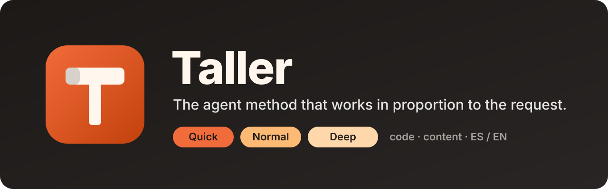

<p align="center">
  
</p>

<p align="center">
  <b>Skills for AI agents that do just enough: fast on small tasks, rigorous on big ones.</b><br>
  Coding and short-form content (TikTok, Reels, Shorts), Spanish-first and bilingual.
</p>

<p align="center">
  <a href="README.md">Español</a> ·
  <a href="docs/instalacion.md">Step-by-step install (ES)</a> ·
  <a href="#real-results">Results</a> ·
  <a href="#faq">FAQ</a> ·
  <a href="CHANGELOG.md">Changelog</a>
</p>

<p align="center">
  
  
  
  
</p>

---

## What it is

**Taller** ("workshop") is a pack of 16 skills so your AI agent (Claude Code, Codex, ChatGPT, Cursor, Claude.ai) works in proportion to the request: a color tweak takes seconds and needs no plan; a migration gets a plan, a budget and a review. Use it for coding and for hooks, scripts and Reels or TikTok calendars. Nothing is called "done" without proof.

Current version: **v1.3.0**.

## Why Taller

Heavy methodologies run the same ritual for everything: questions, a plan, subagents and review, even when you ask to change one word. They shine on big projects but are slow and costly day to day. Taller keeps the best of that approach and scales it to the task.

| | Heavy methodology | Taller |
|---|---|---|
| Small request | Same ritual as a big one | **Quick mode:** does it and shows proof |
| Cost | Discovered at the end | **Visible budget:** pauses at 80% and asks |
| Instructions read | Loads everything | **Reads only the skills for the request type** |
| Questions | Several rounds | Up to 3, only when a wrong guess means redoing work |
| Short-form content | Not included | Hooks, scripts, storyboards and calendars |
| Language | English | Spanish-first, replies in your language |
| No plugins | Not applicable | One file to paste into ChatGPT or Claude |

## Real results

Measured on 16 Nov 2026 in ChatGPT Codex, same prompts before and after v1.1:

| Request | Before (v1.0.1) | After (v1.1) | Quality |
|---|---|---|---|
| 5 hooks + 30 s script for a micro-drama | 3 min 42 s | **32 s** | Same: exactly 5 scored hooks, timing table, verified length |
| A week of Reels for a new store | ~4 min | **17 s** | Same: 3 realistic Reels, neutral hashtags, metrics with decisions |

**Blind A/B (v1.0):** across 3 requests (a trivial change, a CLI with tests, a script), Taller scored **66/75** vs **59/75** without skills. In fairness: the same model generated both arms and judged them, so the result is biased. Details and limitations in [evals/resultados-v1.md](evals/resultados-v1.md); the full 10-prompt plan with an independent judge is in [evals/](evals/README.md) so anyone can rerun it.

**Coding A/B (v1.2 vs Superpowers v7.0.2, 16 Nov 2026, Codex CLI 0.169.0):** on 3 programming tasks (a color tweak, a flaky test and a CSV→JSON CLI), Taller scored **138/150** and Superpowers **133/150**. Taller was faster in 4 of 5 valid comparisons and used fewer tokens on tasks 2 and 3. The gap is small: these data do not support claiming Superpowers is slow on tiny changes. The scorer knew the labels, and the same kind of model generated and judged the work. v1.3 fixes the 5 gaps found in that test.

Every failure found in real tests becomes an automatic regression in [evals/regresiones/](evals/regresiones/README.md).

## Quick install

> Full step-by-step guide (Spanish): [docs/instalacion.md](docs/instalacion.md).

**Claude Code**
```bash
claude plugin marketplace add contenidoinmobiliario79-tech/taller
claude plugin install taller@taller-marketplace
```

**Codex (CLI, app or ChatGPT Work mode)**
Download or clone the repo. In ChatGPT, open **Work**, create a project and add the `taller` folder under **Source folders**. Start with: `Read AGENTS.md and use the skills in the skills folder for this request.` In the CLI, Taller is not listed under `/plugins`: copy `skills/` into the project's `.agents/skills/` (or `~/.agents/skills`) and place `AGENTS.md` at the repo root. Commands are in [docs/instalacion.md](docs/instalacion.md#4-codex-cli) (Spanish).

**Cursor**
Copy or link the folder as a local plugin (it ships `.cursor-plugin/plugin.json`) and reload Cursor.

**ChatGPT or Claude without plugins**
Paste [`dist/taller-chatgpt.md`](dist/taller-chatgpt.md) (under 7,500 characters) into the **project instructions**. It bundles the method and the four content skills.

**Claude.ai skills**
Run `scripts/empaquetar-claude-ai.sh` (or `.ps1` on Windows) and upload the ZIPs from `dist/claude-ai/` in **Customize > Skills**.

## Try it in 1 minute

Paste any of these requests:

- `Give me 5 hooks and a 30-second script for chapter 3 of a micro-drama: she finds out her partner betrayed her.`
- `Plan a week of Reels for a modest-fashion shop that is just getting started.`
- `Change the Submit button color to blue #1E66F5.`

## Skills

| Branch | Skill | What it does |
|---|---|---|
| Core | `taller-inicio` | Picks Quick, Normal or Deep mode and which skills to read. |
| | `entender-pedido` | Clarifies goal and purpose with up to 3 questions. |
| | `plan-con-presupuesto` | Task plan with done-criteria and cost. |
| | `ejecutar-y-revisar` | Executes inline or with subagents; reviews by risk. |
| | `verificar` | Requires evidence before claiming done. |
| | `causa-raiz` | Debugs by reproducing, isolating and confirming. |
| | `cerrar-trabajo` | Summarizes, reports cost, suggests next steps. |
| Code | `tests-primero` | Failing test, minimal code, refactor. |
| | `rama-aislada` | Separate branch or worktree, PowerShell included. |
| | `revision-de-codigo` | Review with severities and verification. |
| Content | `gancho-3-segundos` | Exactly the number of hooks requested, scored, plus one A/B variant. |
| | `guion-corto` | Time · Voice · On-screen text · Shot · Sound table and `N words ÷ 2.5 = X s`. |
| | `storyboard-y-portada` | A fixed character sheet so the protagonist looks the same in every image. |
| | `calendario-de-contenido` | Realistic week (3 pieces by default), batched shooting, metrics. |
| Meta | `crear-skill` | Create or improve skills with an eval from day one. |
| | `diagnostico` | Explains why a session was slow or expensive. |

Skill instructions are written in Spanish; agents follow them in any language and reply in the user's language (set `"idioma": "en"` in `taller.config.json` to force English).

## FAQ

**Is it compatible with Superpowers?**
You can use it instead or alongside. Run the prompts in [evals/prompts/ab-10.md](evals/prompts/ab-10.md) with each and keep what works best for you.

**Does it send data anywhere?**
No. No analytics, no network calls, hooks are off by default ([hooks/README.md](hooks/README.md)).

**How do I configure it?**
Optional: copy `taller.config.example.json` to `taller.config.json`. See [docs/configuracion.md](docs/configuracion.md).

**Why 2.5 words per second?**
It is a natural Spanish speaking pace, and one single pace makes all pieces comparable.

## Contributing

Ideas, bug reports and new skills are welcome. See [CONTRIBUTING.md](CONTRIBUTING.md): every change ships with its eval and passes `tests/validar.sh`, which also runs on every pull request.

## License

MIT © 2026 Yuliet Gutierrez. See [LICENSE](LICENSE).
