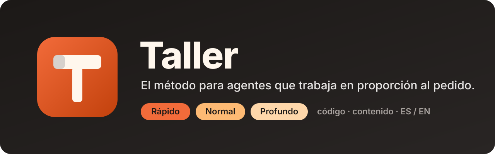

<p align="center">
  
</p>

<p align="center">
  <b>Skills para agentes de IA que hacen lo justo: rápido en lo chico, riguroso en lo grande.</b><br>
  Programación y contenido corto (TikTok, Reels, Shorts), en español y en inglés.
</p>

<p align="center">
  <a href="README.en.md">English</a> ·
  <a href="docs/instalacion.md">Instalación paso a paso</a> ·
  <a href="#resultados-reales">Resultados</a> ·
  <a href="#preguntas-frecuentes">Preguntas frecuentes</a> ·
  <a href="CHANGELOG.md">Cambios</a>
</p>

<p align="center">
  
  
  
  
</p>

---

## Qué es

**Taller** es un pack de 16 skills para que tu agente de IA (Claude Code, Codex, ChatGPT, Cursor, Claude.ai) trabaje en proporción al pedido: un cambio de color se hace en segundos y sin plan; una migración lleva plan, presupuesto y revisión. Sirve para programar y para armar ganchos, guiones y calendarios de Reels o TikTok. Nada se da por "listo" sin mostrar la prueba.

Versión actual: **v1.3.0**.

## Por qué Taller

Las metodologías pesadas aplican el mismo ritual a todo: preguntas, plan, subagentes y revisión, aunque pidas cambiar una palabra. Funcionan bien en proyectos grandes, pero en el día a día son lentas y caras. Taller toma lo mejor de ese enfoque y lo ajusta al tamaño de cada tarea.

| | Metodología pesada | Taller |
|---|---|---|
| Pedido chico | Mismo ritual que uno grande | **Modo Rápido:** lo hace y muestra la prueba |
| Costo | Se descubre al final | **Presupuesto visible:** frena al 80 % y pregunta |
| Lectura de instrucciones | Carga todo | **Lee solo las skills del tipo de pedido** |
| Preguntas | Varias rondas | Hasta 3, y solo si adivinar mal obliga a rehacer |
| Contenido corto | No incluido | Ganchos, guiones, storyboard y calendario |
| Idioma | Inglés | Español primero, responde en tu idioma |
| Sin plugins | No aplica | Un archivo para pegar en ChatGPT o Claude |

## Resultados reales

Mediciones del 16/11/2026 en ChatGPT Codex, con los mismos pedidos antes y después de la v1.1:

| Pedido | Antes (v1.0.1) | Después (v1.1) | Calidad |
|---|---|---|---|
| 5 ganchos + guion de 30 s para una micro-novela | 3 min 42 s | **32 s** | Igual: 5 ganchos exactos con puntaje, tabla de tiempos y duración verificada |
| Semana de Reels para una tienda nueva | ~4 min | **17 s** | Igual: 3 Reels realistas, hashtags neutros y métricas con decisión |

**A/B a ciegas (v1.0):** en 3 pedidos (un cambio trivial, una CLI con tests y un guion), Taller sacó **66 de 75 puntos** y la versión sin skills **59 de 75**. Para ser honestas: el mismo modelo generó las dos versiones y también juzgó, así que hay sesgo. Los detalles y las limitaciones están en [evals/resultados-v1.md](evals/resultados-v1.md). El plan completo de 10 pedidos con juez independiente está en [evals/](evals/README.md) para que cualquiera lo repita.

**A/B de código (v1.2 vs Superpowers v7.0.2, 16/11/2026, Codex CLI 0.169.0):** en 3 tareas de programación (un color, un test intermitente y una CLI CSV→JSON), Taller sacó **138 de 150** y Superpowers **133 de 150**. Taller fue más rápido en 4 de 5 comparaciones válidas y usó menos tokens en las tareas 2 y 3. La diferencia es chica: no conviene afirmar que Superpowers es lento en un cambio chico con estos datos. La puntuación la hizo quien armó la prueba, sin ocultar los nombres, y el mismo tipo de modelo generó y juzgó. La v1.3 corrige las 5 fallas que aparecieron en esa prueba.

Cada falla encontrada en pruebas reales queda como regresión automática en [evals/regresiones/](evals/regresiones/README.md).

## Instalación rápida

> Guía con todos los pasos: [docs/instalacion.md](docs/instalacion.md).

**Claude Code**
```bash
claude plugin marketplace add contenidoinmobiliario79-tech/taller
claude plugin install taller@taller-marketplace
```

**Codex (CLI, app o modo Work de ChatGPT)**
Descargá o cloná el repo. En ChatGPT, entrá en **Work**, creá un proyecto y en **Carpetas de origen** agregá la carpeta `taller`. En el primer mensaje escribí: `Leé AGENTS.md y usá las skills de la carpeta skills para este pedido.` En la CLI, Taller no aparece en `/plugins`: copiá `skills/` a `.agents/skills/` de tu proyecto (o a `~/.agents/skills`) y dejá `AGENTS.md` en la raíz. Los comandos están en [docs/instalacion.md](docs/instalacion.md#4-codex-cli).

**Cursor**
Copiá o enlazá la carpeta como plugin local (incluye `.cursor-plugin/plugin.json`) y recargá Cursor.

**ChatGPT o Claude sin plugins**
Pegá [`dist/taller-chatgpt.md`](dist/taller-chatgpt.md) (menos de 7.500 caracteres) en las **instrucciones del proyecto**. Trae el método y las cuatro skills de contenido en un solo archivo.

**Claude.ai con skills**
Corré `scripts/empaquetar-claude-ai.sh` (o `.ps1` en Windows) y subí los ZIP de `dist/claude-ai/` en **Customize > Skills**.

## Probalo en 1 minuto

Pegá cualquiera de estos pedidos:

- `Dame 5 ganchos y un guion de 30 segundos para el capítulo 3 de una micro-novela: ella descubre que su socio la traicionó.`
- `Planificá una semana de Reels para una tienda de ropa modesta que recién empieza.`
- `Cambiá el color del botón Enviar a azul #1E66F5.`

## Las skills

| Rama | Skill | Qué hace |
|---|---|---|
| Núcleo | `taller-inicio` | Elige el modo Rápido, Normal o Profundo y qué skills leer. |
| | `entender-pedido` | Aclara objetivo y para qué con hasta 3 preguntas. |
| | `plan-con-presupuesto` | Plan por tareas con criterio de hecho y costo. |
| | `ejecutar-y-revisar` | Ejecuta solo o con subagentes y revisa según el riesgo. |
| | `verificar` | Pide evidencia antes de dar algo por terminado. |
| | `causa-raiz` | Depura reproduciendo, aislando y confirmando la causa. |
| | `cerrar-trabajo` | Resume, informa el costo y propone próximos pasos. |
| Código | `tests-primero` | Test que falla, código mínimo, ordenar. |
| | `rama-aislada` | Rama o worktree aparte, también en PowerShell. |
| | `revision-de-codigo` | Revisión con severidades y verificación. |
| Contenido | `gancho-3-segundos` | La cantidad exacta de ganchos pedida, con puntaje y una variante A/B. |
| | `guion-corto` | Tabla Tiempo · Voz · Texto · Toma · Sonido y `N palabras ÷ 2,5 = X s`. |
| | `storyboard-y-portada` | Ficha de personaje fija para que la protagonista sea siempre la misma. |
| | `calendario-de-contenido` | Semana realista (3 piezas si no se dice), grabación agrupada y métricas. |
| Meta | `crear-skill` | Crear o mejorar skills con su eval desde el primer día. |
| | `diagnostico` | Explica por qué una sesión salió cara o lenta. |

```
taller-inicio ─┬─ Rápido ──► hacer ─► verificar
               ├─ Normal ──► entender-pedido ─► ejecutar-y-revisar ─► cerrar-trabajo
               └─ Profundo ► entender-pedido ─► plan-con-presupuesto ─► rama-aislada
                             ─► ejecutar-y-revisar (subagentes) ─► revision-de-codigo ─► cerrar-trabajo
Ramas: bug ► causa-raiz · código ► tests-primero · video corto ► gancho ► guion ► storyboard ► calendario
En un cambio chico no se abre taller-inicio: solo verificar.
```

## Preguntas frecuentes

**¿Necesito un plan pago?**
Para el archivo de pegar alcanza con una cuenta que tenga proyectos o instrucciones personalizadas. Claude Code y Codex usan el plan que pida cada herramienta.

**¿Funciona en inglés?**
Sí. Las instrucciones están en español, pero el agente responde en el idioma de la persona. Con `"idioma": "en"` en `taller.config.json` se fuerza el inglés.

**¿Reemplaza a otras metodologías como Superpowers?**
Se puede usar en su lugar o al lado. Si ya usás una, probá los pedidos de [evals/prompts/ab-10.md](evals/prompts/ab-10.md) con cada una y quedate con la que te dé mejores resultados.

**¿Manda datos a algún lado?**
No. No hay analítica ni llamadas de red, y los hooks vienen apagados ([hooks/README.md](hooks/README.md)).

**¿Cómo lo configuro?**
Es opcional: copiá `taller.config.example.json` como `taller.config.json`. Ver [docs/configuracion.md](docs/configuracion.md).

**¿Por qué los guiones usan 2,5 palabras por segundo?**
Es un ritmo natural de habla en español y, al usar uno solo, los tiempos de todas las piezas son comparables.

## Contribuir

Las ideas, fallas y skills nuevas son bienvenidas. Leé [CONTRIBUTING.md](CONTRIBUTING.md): cada cambio trae su eval y pasa `tests/validar.sh`, que también corre automáticamente en cada pull request.

## Licencia

MIT © 2026 Yuliet Gutierrez. Ver [LICENSE](LICENSE).
