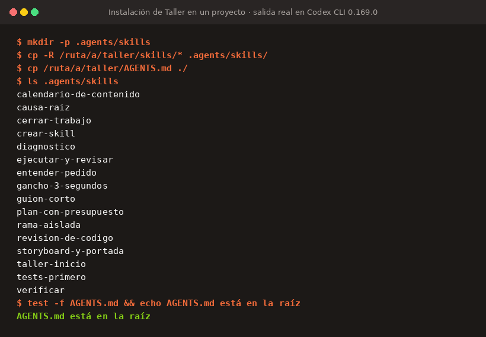
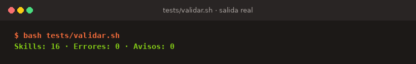

# Instalación paso a paso

Elegí tu herramienta. Cada camino termina con una prueba para confirmar que Taller está funcionando.

- [1. ChatGPT: modo Work (Codex) con carpeta de origen](#1-chatgpt-modo-work-codex-con-carpeta-de-origen) · recomendado
- [2. ChatGPT o Claude: pegar el archivo en un proyecto](#2-chatgpt-o-claude-pegar-el-archivo-en-un-proyecto)
- [3. Claude Code](#3-claude-code)
- [4. Codex CLI](#4-codex-cli)
- [5. Cursor](#5-cursor)
- [6. Claude.ai con skills](#6-claudeai-con-skills)

---

## 1. ChatGPT: modo Work (Codex) con carpeta de origen

1. Descargá el ZIP del repositorio (en GitHub, botón **Code > Download ZIP**) y descomprimilo. Queda una carpeta `taller` con `AGENTS.md` adentro. La dirección del repo es [contenidoinmobiliario79-tech/taller](https://github.com/contenidoinmobiliario79-tech/taller).
2. Abrí la app de ChatGPT y tocá **Work** arriba (el selector de modo, no un chat común).
3. Creá un proyecto nuevo (por ejemplo `taller-codex`).
4. En **Carpetas de origen**, tocá **Agregar** y elegí la carpeta `taller` (la que tiene `AGENTS.md`). Si pregunta si confiás en la carpeta, aceptá.
5. Abrí un chat nuevo en el proyecto y pegá, en el mismo mensaje:

   ```
   Leé AGENTS.md y usá las skills de la carpeta skills para este pedido.
   Planificá una semana de Reels para una tienda de ropa modesta que recién empieza.
   ```

6. **Prueba:** en menos de un minuto tiene que responder con 3 Reels, una línea de supuestos, hashtags sin país y métricas con decisión.

## 2. ChatGPT o Claude: pegar el archivo en un proyecto

1. Abrí [`dist/taller-chatgpt.md`](../dist/taller-chatgpt.md) y copiá todo el texto (menos de 7.500 caracteres).
2. **ChatGPT:** creá un proyecto, entrá en **Configuración del proyecto > Instrucciones**, pegá el texto y guardá.
   **Claude:** creá un proyecto, tocá **Instrucciones del proyecto**, pegá el texto y guardá.
3. **Prueba:** en un chat nuevo del proyecto pedí `Dame 5 ganchos y un guion de 30 segundos para el capítulo 3 de una micro-novela.` Tienen que salir exactamente 5 ganchos y una tabla con `N palabras ÷ 2,5 = X s`.

## 3. Claude Code

1. Instalá el marketplace y el plugin:

   ```bash
   claude plugin marketplace add contenidoinmobiliario79-tech/taller
   claude plugin install taller@taller-marketplace
   ```

   Para probar con una carpeta local sin instalar: `claude --plugin-dir /ruta/a/taller`.
2. Reiniciá Claude Code.
3. **Prueba:** escribí `/plugin` y comprobá que **taller** figura activo. Después pedí `Cambiá el color del botón Enviar a azul.` en cualquier proyecto: lo tiene que hacer sin plan y mostrando el cambio.

## 4. Codex CLI

Taller **no** aparece en el marketplace de Codex (`/plugins` ni `codex plugin list`). La instalación que funciona es copiar las skills a una carpeta que Codex descubre solo, y dejar `AGENTS.md` en la raíz del proyecto para el ruteo. Lo que sigue está comprobado con Codex CLI 0.169.0 (código fuente del tag `rust-v0.169.0` y prueba en Linux).

**En un proyecto** (recomendado):

```bash
mkdir -p .agents/skills
cp -R /ruta/a/taller/skills/* .agents/skills/
cp /ruta/a/taller/AGENTS.md ./
```

En PowerShell (mismas carpetas relativas):

```powershell
New-Item -ItemType Directory -Force -Path .agents\skills | Out-Null
Copy-Item -Recurse \ruta\a\taller\skills\* .agents\skills\
Copy-Item \ruta\a\taller\AGENTS.md .\
```

Codex busca skills en `.agents/skills/` del proyecto. Cada skill queda como `.agents/skills/<nombre>/SKILL.md`.



**En todos tus proyectos de esta computadora:** el código de Codex 0.169.0 busca las skills de usuario en `~/.agents/skills`. Todavía lee `$CODEX_HOME/skills` o, si esa variable no está definida, `~/.codex/skills`, pero esa segunda ruta está marcada como anterior, por compatibilidad. Seguí copiando `AGENTS.md` a la raíz de cada proyecto.

```bash
mkdir -p ~/.agents/skills
cp -R /ruta/a/taller/skills/* ~/.agents/skills/
```

En Windows no se corrió Codex. El home, en esa versión, se resuelve con `dirs::home_dir()` (en el binario aparecen `USERPROFILE` y `HOMEDRIVE`/`HOMEPATH`). En una instalación típica eso equivale a `%USERPROFILE%\.agents\skills` para la ubicación actual y `%USERPROFILE%\.codex\skills` para la anterior. Si definiste `CODEX_HOME`, la anterior es `%CODEX_HOME%\skills`.

1. Cloná o descomprimí el repo de Taller y, en el proyecto donde vas a trabajar, corré el bloque de arriba (cambiando `/ruta/a/taller` por la carpeta real).
2. Abrí Codex dentro de **ese** proyecto; no hace falta elegir nada en `/plugins`.
3. **Prueba:** pedí `Cambiá el color del botón Enviar a azul #1E66F5.` Tiene que hacerlo sin plan, buscar todas las apariciones del color y mostrar la prueba. Para contenido, usá el pedido del calendario de la sección 1.

## 5. Cursor

1. Copiá o enlazá la carpeta del repo como plugin local (incluye `.cursor-plugin/plugin.json`).
2. Recargá la ventana de Cursor.
3. **Prueba:** pedí un guion de 30 segundos; tiene que traer la tabla de tiempos y el conteo de palabras.

## 6. Claude.ai con skills

1. En **Settings > Capabilities**, activá *Code execution and file creation*.
2. Generá un ZIP por skill: `scripts/empaquetar-claude-ai.sh` (macOS/Linux) o `powershell -File scripts\empaquetar-claude-ai.ps1` (Windows).
3. En **Customize > Skills**, tocá **+ > Create skill > Upload a skill** y subí los ZIP de `dist/claude-ai/`. Para empezar: `taller-inicio`, `verificar` y las cuatro de contenido.
4. Activá cada skill con su interruptor.
5. **Prueba:** pedí el mismo guion de 30 segundos de la sección 5.

## Si algo no anda

- **Responde sin el método:** en Work o Codex, empezá el mensaje con la línea de `AGENTS.md` del paso 5 de la sección 1.
- **Tarda mucho:** comprobá que el pedido no pida leer "todas las skills"; Taller lee solo las que corresponden.
- **Otra falla:** abrí un issue con la plantilla **Falla** y pegá el pedido y la respuesta.

El pack se puede comprobar sin una herramienta de chat, en la carpeta del repo:

```bash
bash tests/validar.sh
```



## Capturas que se pueden sumar más adelante

Estas pantallas no se pueden tomar desde acá (hace falta la app o el repo ya publicado). Si más adelante las tenés, el lugar natural es esta guía:

- El botón **Code > Download ZIP** en GitHub (sección 1, paso 1)
- El selector **Work** de ChatGPT (sección 1, paso 2)
- La carpeta `taller` agregada en **Carpetas de origen** (sección 1, paso 4)
- Una respuesta completa del calendario de prueba (sección 1, paso 6)
- El texto pegado en las instrucciones del proyecto (sección 2, paso 2)
- La lista de plugins de Claude Code con **taller** activo (sección 3, paso 3)
- El plugin de Taller cargado en Cursor (sección 5)
- Las skills subidas y activas en Claude.ai (sección 6)
